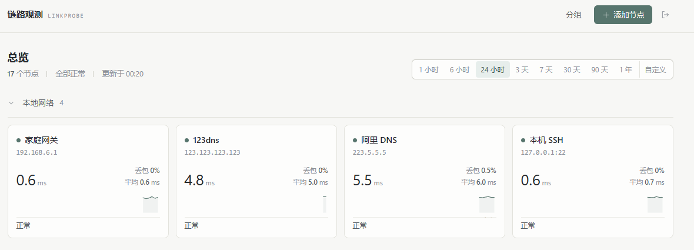

# linkprobe

家庭远程服务器连接质量监控。单个 Go 二进制，内嵌 Vue 3 前端，数据全部存在本机 SQLite；不依赖外部 CDN、在线字体、Redis 或任何云服务，断外网也能正常打开界面。



## 功能

- **两种探测**：ICMP（`golang.org/x/net/icmp`，不派生子进程）和 TCP 建连；每轮默认 5 个包，30 秒一次。
- **多节点与分组**：节点可分组、拖拽排序、折叠；支持暂停、编辑、删除和「测试一次」。
- **三个存储层**：原始样本（默认 7 天）、5 分钟聚合（90 天）、1 小时聚合（730 天），按查询跨度自动选择，避免长范围查询扫原始表。
- **图表**：延迟折线与丢包柱状双图联动、框选缩放、悬停十字线；无数据区间用斜纹显示，和 100% 丢包明确区分。
- **单用户管理**：bcrypt 密码、HttpOnly Cookie 会话、登录限速、Origin 校验、安全响应头。
- **深色模式**：跟随系统，暖灰白设计令牌，6–8px 圆角、1px 分隔线，无渐变与装饰性图标。

## 目录

```
cmd/linkprobe/        进程入口：配置、调度、聚合、HTTP 服务
internal/api/         REST 接口、认证、SPA 回退
internal/config/      YAML + 环境变量配置
internal/probe/       ICMP/TCP 探测、DNS 缓存、调度器
internal/pipeline/    批量写库、5m/1h 聚合、补算
internal/store/       SQLite schema、查询、保留期清理
internal/rangeplan/   时间范围 → 粒度 / 数据层
internal/health/      主机健康指标
web/                  Vue 3 + Vite + ECharts（按需引入）
deploy/               systemd 单元与安装脚本
tools/fakegen/        演示数据生成与查询压测（不参与服务构建）
scripts/build.sh      Linux / macOS 构建脚本（前端 + 交叉编译）
scripts/build.ps1     Windows 构建脚本（前端 + arm64 交叉编译）
```

## 版本历史

- **1.0.1**：修复总览页「未分组」分组常驻拖拽高亮的问题。此前 `overGroup` 的初始值 `null` 与未分组的 `group.id === null` 相等，导致该分组一直被渲染成 `.group-drop.over`（`--accent-soft` 底色 + 内描边），在节点不满一行时右侧空余区域会露出一块异色；现在改为按 `groupKey()` 比较且要求拖拽进行中才高亮。
- **1.0.0**：首个版本。

## 构建

依赖：Go 1.23+；修改前端时需要 Node 20+。

仓库已经包含构建好的 `web/dist`，所以只改后端时可以直接：

```bash
go build ./cmd/linkprobe
go test ./...
```

前端改动后需要重新构建（产物通过 `go:embed` 打进二进制）：

Windows：

```powershell
powershell -ExecutionPolicy Bypass -File scripts/build.ps1
# 产物：build/linkprobe-linux-arm64
```

Linux / macOS：

```bash
make build-arm64      # 或 make build / make build-amd64
```

`scripts/build.ps1` 和 `Makefile` 会先执行 `npm install` + `npm run build`，再编译 Go 二进制。

## 部署（Debian 12 / arm64 实测）

```bash
# 1. 把二进制传到目标机
scp build/linkprobe-linux-arm64 user@<主机IP>:/tmp/linkprobe-new

# 2. 安装或升级（保留配置和数据，重启服务）
sudo install -m 755 /tmp/linkprobe-new /opt/linkprobe/linkprobe
sudo systemctl restart linkprobe
```

全新安装可以直接在仓库目录执行：

```bash
sudo deploy/install.sh /tmp/linkprobe-new
```

它会创建 `linkprobe` 系统用户、`/opt/linkprobe`、`/etc/linkprobe/config.yaml`、`/var/lib/linkprobe`，并启用 systemd 单元。

关键点：

- ICMP 使用 raw socket，单元文件通过 `AmbientCapabilities=CAP_NET_RAW` 授权，进程本身仍是普通用户。
- `ProtectSystem=strict` + `ReadWritePaths=/var/lib/linkprobe`，只有数据目录可写。
- 默认监听 `0.0.0.0:8090`。界面地址：`http://<主机IP>:8090`。
- 日志：`journalctl -u linkprobe -f`。

## 配置

配置文件 `/etc/linkprobe/config.yaml`，环境变量优先级更高，便于临时覆盖。

```yaml
listen: "0.0.0.0:8090"
data_dir: "/var/lib/linkprobe"
admin_password_hash: "$2a$12$..."   # linkprobe -hash-password=你的密码
session_ttl_hours: 72
trust_proxy: false

retention:
  raw_days: 7
  rollup_5m_days: 90
  rollup_1h_days: 730

probe:
  max_concurrent: 32      # 同时进行的探测轮数
  write_batch_seconds: 30 # 写库批量提交间隔
  dns_cache_minutes: 5
  packet_gap_ms: 400      # 一轮内包间隔
```

常用环境变量：`LINKPROBE_LISTEN`、`LINKPROBE_DATA_DIR`、`LINKPROBE_ADMIN_PASSWORD_HASH`、`LINKPROBE_MAX_CONCURRENT`、`LINKPROBE_RAW_RETENTION_DAYS` 等。

时间约定：库内全部是 **UTC 秒级时间戳**，前端按浏览器时区显示。程序启动时会检查系统时间是否早于构建时间；若明显偏差，会等 NTP 校准后再开始探测，避免写入错误时间。

## 数据与聚合

| 表 | 内容 | 默认保留 |
| --- | --- | --- |
| `samples_raw` | 每轮探测的 sent/recv、RTT min/avg/max | 7 天 |
| `rollup_5m` | 5 分钟桶的 sent/recv、RTT sum/min/max | 90 天 |
| `rollup_1h` | 1 小时桶，由 5m 再聚合 | 730 天 |

- 聚合每 30 秒刷新一次最近窗口（含当前未关闭的桶），启动时先补算断档区间。
- 清理任务按时间窗口分块删除，避免大事务卡住写入。
- 查询层选择：`≤24h` 用原始数据；跨度在 5m 保留期内且粒度 ≤1h 用 5m；其余用 1h。自定义范围从 `30s/1m/5m/15m/30m/2h/6h/1d` 中选最小的、使点数 ≤400 的粒度。
- 丢包率 = `1 - Σrecv/Σsent`；没有样本的桶保持为 null（斜纹），不会画成 0。

## REST 接口

除登录与会话外都需要 Cookie。

```
GET    /api/session
POST   /api/login              {"password":"..."}
POST   /api/logout

GET    /api/overview
GET    /api/nodes
POST   /api/nodes
GET    /api/nodes/{id}
PATCH  /api/nodes/{id}
DELETE /api/nodes/{id}
PUT    /api/nodes/order
POST   /api/nodes/{id}/test
POST   /api/probe/test         {"type":"icmp","host":"223.5.5.5",...}

GET    /api/nodes/{id}/series?range=6h
GET    /api/nodes/{id}/series?from=...&to=...
GET    /api/system

GET    /api/groups
POST   /api/groups
PATCH  /api/groups/{id}
DELETE /api/groups/{id}
PUT    /api/groups/order
```

`/api/*` 未匹配的路径统一返回 JSON 404；缺失的静态资源返回 404，不会回退到 `index.html`。

## 测试与实测

单元测试覆盖聚合、丢包率、范围/粒度选择、探测参数校验、路由与认证等：

```bash
go test ./...
```

### 演示数据与查询压测

`tools/fakegen` 可生成 50 个节点、30 天原始样本，并用生产聚合代码生成 5m/1h 层，再补一年的小时级历史：

```bash
go run ./tools/fakegen -db ./fake.db -nodes 50 -days 30 -history 335 -bench
```

本机开发环境（Windows，50 节点，30 天原始 + 365 天小时层，数据库 143 MiB）：

| 查询 | 点数 | p50 | p95 | 目标 |
| --- | --- | --- | --- | --- |
| 24 小时 / 5m | 14 350 | 1.0 ms | 1.5 ms | < 100 ms |
| 1 年 / 1d | 18 300 | 8.1 ms | 9.1 ms | < 300 ms |

目标机实测（Debian 12 arm64，4 核 4 GB，eMMC，同一份 143 MiB 数据库，走真实 HTTP 接口）：

| 查询 | p50 | p95 | 目标 |
| --- | --- | --- | --- |
| 24 小时 / 5m（约 30 KB JSON） | 17.4 ms | 20.0 ms | < 100 ms |
| 1 年 / 1d（约 41 KB JSON） | 109.7 ms | 111.4 ms | < 300 ms |

### 50 节点探测负载

在同一台目标机上以独立数据目录和 8091 端口运行 50 个节点（30 秒一轮、每轮 5 包），取 9.4 分钟稳态窗口（29 个采样点）：

- CPU：**1.34%** 单核
- 常驻内存 RSS：**16.3–20.0 MB**
- 磁盘写入：**0.074 MB/分钟**（约 1.27 KB/s）
- 原始样本写入：**99.2 行/分钟**，与 50 节点 × 2 轮/分钟吻合
- 数据库体积：50 节点 / 30 天原始 + 一年小时层约 **143 MiB**

指标全部满足目标（CPU < 5%、RSS < 120 MB、写盘 < 1 MB/分钟、24h 查询 < 100 ms、1 年 < 300 ms）。

24 小时长稳：建议在目标机用独立数据目录和端口再跑一个 50 节点实例，每 5 分钟记录 CPU / RSS / 写盘到 CSV，连续观察 24 小时，确认没有持续增长。上面 9 分钟稳态窗口的数据已经满足全部资源指标。


## 已知边界

- 单管理员、单密码；会话保存在内存中，服务重启后需要重新登录。
- 不提供多用户、告警推送、外部导出；数据只在本机。
- 前端 ECharts 按需引入后，节点详情页 JS 约 554 KB（gzip 187 KB），可接受但仍是最大的静态资源。
- 若目标机存在透明代理/防火墙拦截，TCP 探测可能 100% 超时，这是网络行为而非程序错误。
